# Wallscreen

An animated wallpaper for KDE Plasma 6 that follows the time of day and the live weather where
you are. The sun and moon cross the sky, and the clouds, rain, snow, fog and thunderstorms on
screen match the weather outside. There are four styles.

The motion is slow and quiet on purpose, so it stays easy on the eyes all day. Animation stops
on battery and while a maximized or fullscreen window covers the screen.

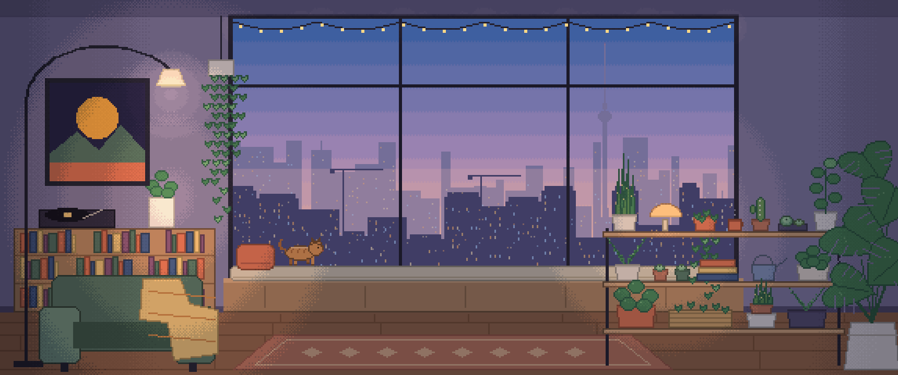

## Styles

### Pixel Loft

A modern loft in pixel art, with a large window onto a city skyline where the sky and the
weather show. When it gets dark, the lights come on in the city and in the room. The cat
sleeps on the window bench, and every ten minutes or so it gets up and walks along it.

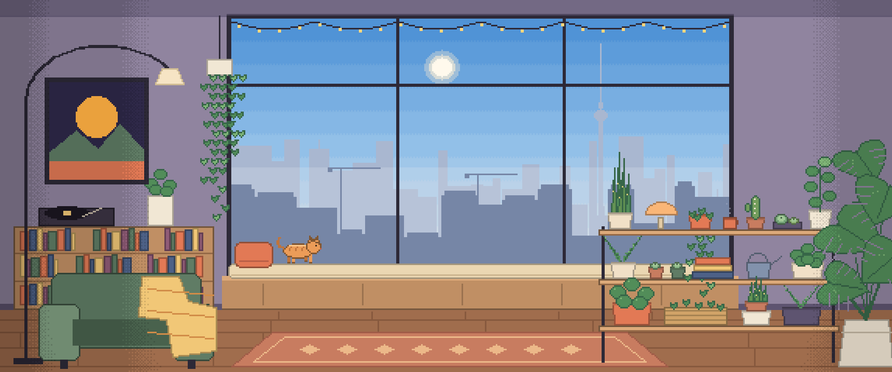 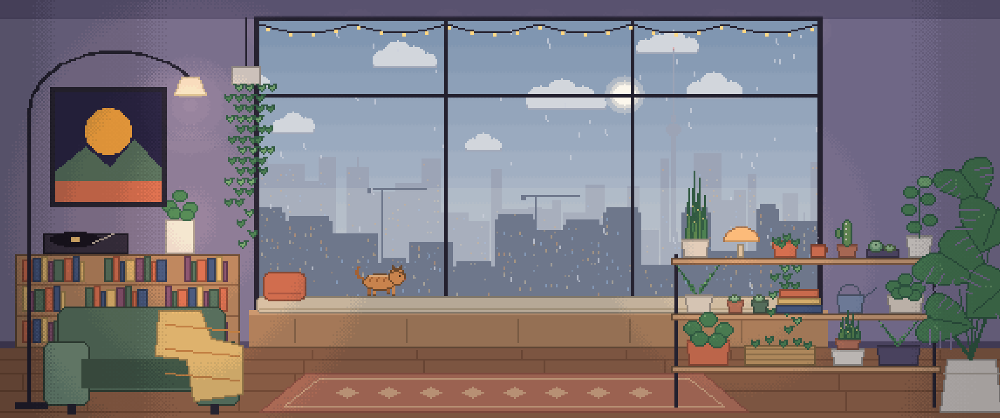 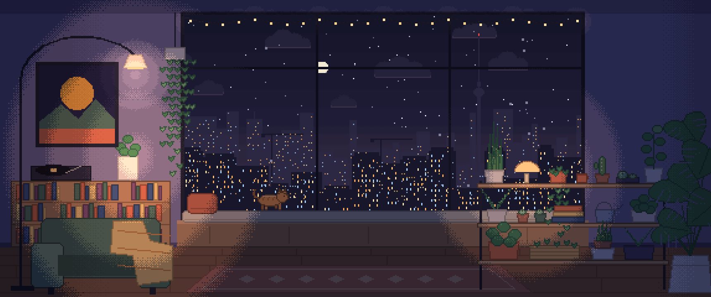

### Woodblock (ukiyo-e)

A landscape in the style of a Japanese woodblock print on washi paper, with a snow-capped
volcano, layered hills with pines and a small pagoda. The hills change colour with the
seasons, and so do the petals or leaves that drift past. Fireflies come out on summer nights,
and by day a flock of birds crosses the sky now and then.

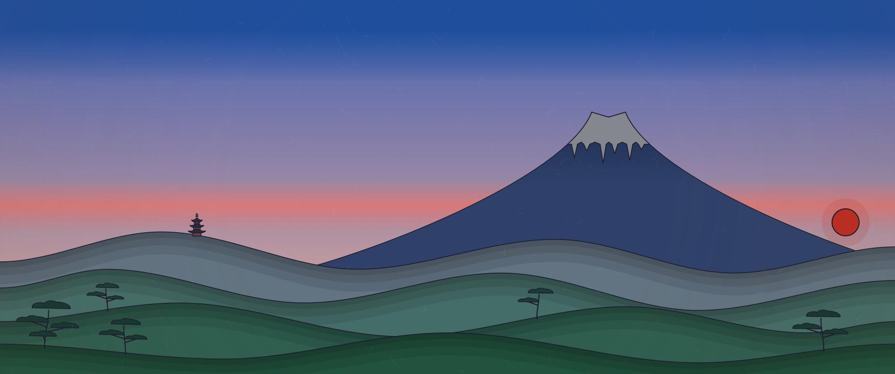

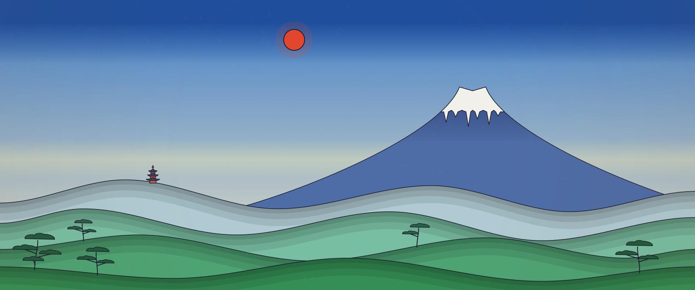 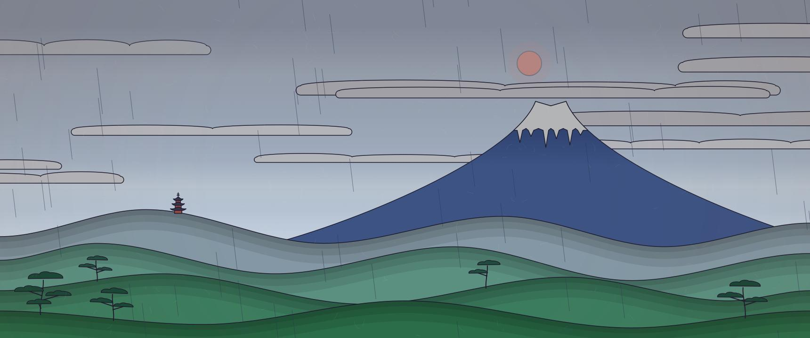 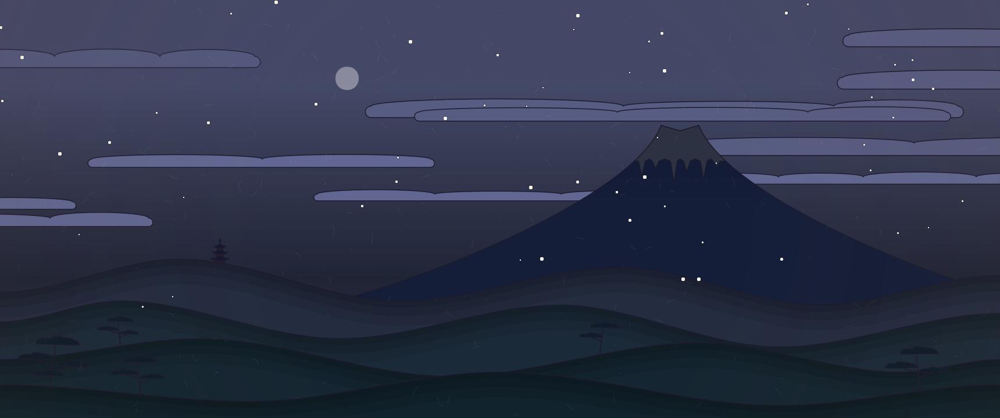

### Lofi Window

A cosy room window looking out over a city, with a cat on the sill, plants, books, a mug of
coffee and fairy lights. When it rains, drops bead and run down the glass. Snow leaves frost
and a small drift on the ledge, and in a thunderstorm the lightning lights up the room.

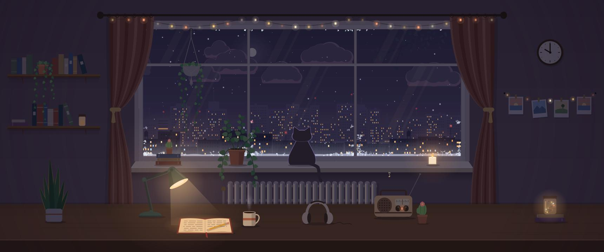

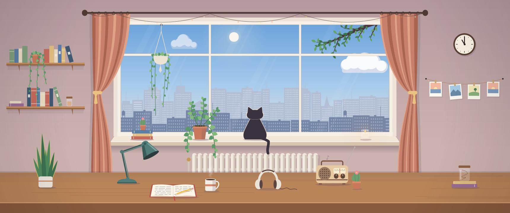 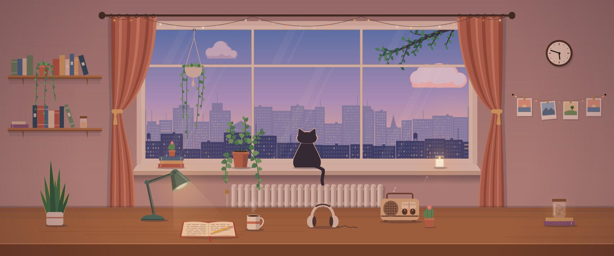 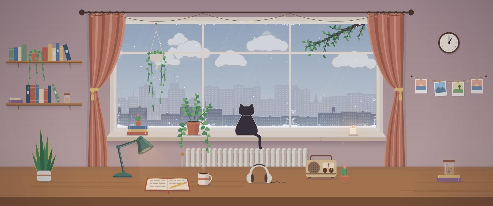

### Sunlit Ocean (painting)

A painting of the open sea between banks of cloud. Small clouds drift over the water with
their shadows moving below them, while glints flash along the sun's path and the rays sway.
This style always shows the same sunny day, whatever the time or the weather.


## Requirements

- KDE Plasma 6 (developed on Plasma 6.6 with Qt 6.10, on Wayland)
- An internet connection for the weather. Without one, the wallpaper uses the last forecast
  it received, or clear skies.

Weather comes from [Open-Meteo](https://open-meteo.com/), which needs no account or API key.
The wallpaper looks up the city when you enter it, then fetches the forecast every 15 minutes.

The wallpaper runs only on Plasma, so it does not work on GNOME, macOS or Windows.

## Resource use

Measured with `tools/bench.sh` on a Ryzen 7 PRO 5850U with its integrated Radeon graphics, on one 3440x1440 screen
at 100 Hz, Plasma 6.6 on Wayland, during light rain. Each value is a 20-second average taken
after the style had settled for 35 seconds.

```
+--------------+-----------------+----------+----------+-----------------+
| Style        | plasmashell CPU | KWin CPU | GPU busy | plasmashell RAM |
+--------------+-----------------+----------+----------+-----------------+
| Paused       |           0-6 % |   0-13 % |   0-23 % |        ~450 MiB |
| Woodblock    |             9 % |      5 % |     21 % |         473 MiB |
| Lofi Window  |            19 % |      6 % |     22 % |         494 MiB |
| Sunlit Ocean |             4 % |      6 % |     19 % |         522 MiB |
| Pixel Loft   |            10 % |     11 % |     28 % |         483 MiB |
+--------------+-----------------+----------+----------+-----------------+
```

CPU is the share of one core. GPU busy covers the whole GPU, including everything else on
screen, so it varies by several points between runs; the paused row shows that range. RAM is the whole plasmashell process with its panels and widgets,
and the styles differ from each other by about 50 MiB. Every style draws on its own slow clock
(25 frames a second for Woodblock and Lofi Window, 12.5 for Sunlit Ocean and Pixel Loft)
instead of at the display's refresh rate, and stops drawing while paused.

## Installation

```sh
git clone https://github.com/frodo4fingers/wallscreen.git
cd wallscreen
kpackagetool6 -t Plasma/Wallpaper -i package
```

Then right-click the desktop, choose **Desktop and Wallpaper…**, set **Wallpaper type** to
**Wallscreen**, and pick a style.

To update after a `git pull`:

```sh
kpackagetool6 -t Plasma/Wallpaper -u package
systemctl --user restart plasma-plasmashell
```

Plasma caches the QML files, so the restart is needed before changes show up.

To uninstall:

```sh
kpackagetool6 -t Plasma/Wallpaper -r de.wallscreen.weather
```

## Settings

| Setting | What it does |
| --- | --- |
| Style | Pixel Loft, Woodblock, Lofi Window or Sunlit Ocean |
| City | Where the weather comes from. The resolved place is shown below the field. |
| Pause animation on battery | On by default |
| Pause when a maximized or fullscreen window covers the screen | On by default |
| Preview weather | Shows clear, cloudy, rain, snow, storm or fog instead of the live weather |
| Override time of day | Shows a fixed hour instead of the current time |

The `ws` script in the repository root sets the preview on every screen from the command
line, which is handy while working on a style:

```sh
./ws 3 22   # rain at 22:00
./ws 4 12   # snow at noon
./ws 0      # back to live weather and time
```

Weather: 0 live, 1 clear, 2 cloudy, 3 rain, 4 snow, 5 storm, 6 fog. Hour: 0 to 23, or -1 for
the current time.

## Development

```
package/                     the Plasma wallpaper package
  metadata.json
  contents/config/main.xml   settings schema
  contents/ui/
    main.qml                 weather, sun and moon, pause logic; builds `world` for the styles
    Weather.qml              Open-Meteo lookup, polling and offline cache
    logic.js                 pure functions: weather codes, sun and moon position, light
    config.qml               settings page
    styles.js                list of styles shown in the settings
    styles/<id>/Scene.qml    one folder per style
tests/                       Qt Quick Test suites
tools/
  pixel_loft.py              generates the Pixel Loft room and cat sprites (Pillow, NumPy)
  pixel_preview.js           renders the Pixel Loft window view with Node, for quick checks
  screenshots.qml            renders the README screenshots offscreen
  bench.sh                   measures CPU, GPU and memory per style on the live desktop
```

[AGENTS.md](AGENTS.md) collects the rules for contributors, whether people or coding agents.
The main one is that every style moves on a slow clock, and it lists the checks to run before
committing.

Run the tests from the repository root:

```sh
for t in tst_logic tst_woodblock tst_smoke; do
    QT_QPA_PLATFORM=offscreen /usr/lib/qt6/bin/qmltestrunner -input tests/$t.qml
done
```

Render the screenshots again after changing a style:

```sh
QT_QPA_PLATFORM=offscreen /usr/lib/qt6/bin/qmltestrunner -input tools/screenshots.qml
```

The offscreen renderer has no shader support, so effects such as the blur behind the Lofi
Window's wet glass are missing from these pictures, although they work on the desktop.

### Writing a style

A style is a folder under `package/contents/ui/styles/` with a `Scene.qml`, registered in
`styles.js`. The scene's root Item has one input, `property var world`, which `main.qml`
sets to an object with these properties:

| Property | Meaning |
| --- | --- |
| `now`, `latitude`, `month` | Current time, the city's latitude, and the month (0 to 11, shifted by six on the southern hemisphere) |
| `elevation` | Sun height from -1 (midnight) through 0 (sunrise and sunset) to 1 (noon) |
| `light` | Overall daylight from 0.15 to 1, lower when overcast |
| `sunX`, `sunY`, `moonX`, `moonY` | Positions as fractions of the screen; the horizon is at y = 0.62 |
| `sunVisible`, `moonVisible`, `moonPhase`, `starOpacity` | Moon phase is 0 for new moon and 0.5 for full moon |
| `clouds`, `rain`, `snow`, `fog`, `storm` | 0 to 1, already smoothed so changes fade in |
| `windX` | -1 to 1, positive blows to the right |
| `running` | False while the wallpaper is paused; stop all timers and animations then |
| `instant` | True for a moment after a preview change, so a style can skip its colour fades |

`world` is null while the scene loads, so read it with defaults (`world?.rain ?? 0`). A
wallpaper runs all day and every frame costs power, so keep animation on a slow timer instead
of the display's frame rate, and repaint canvases only when what they show has changed.

## License

[MIT](LICENSE)
